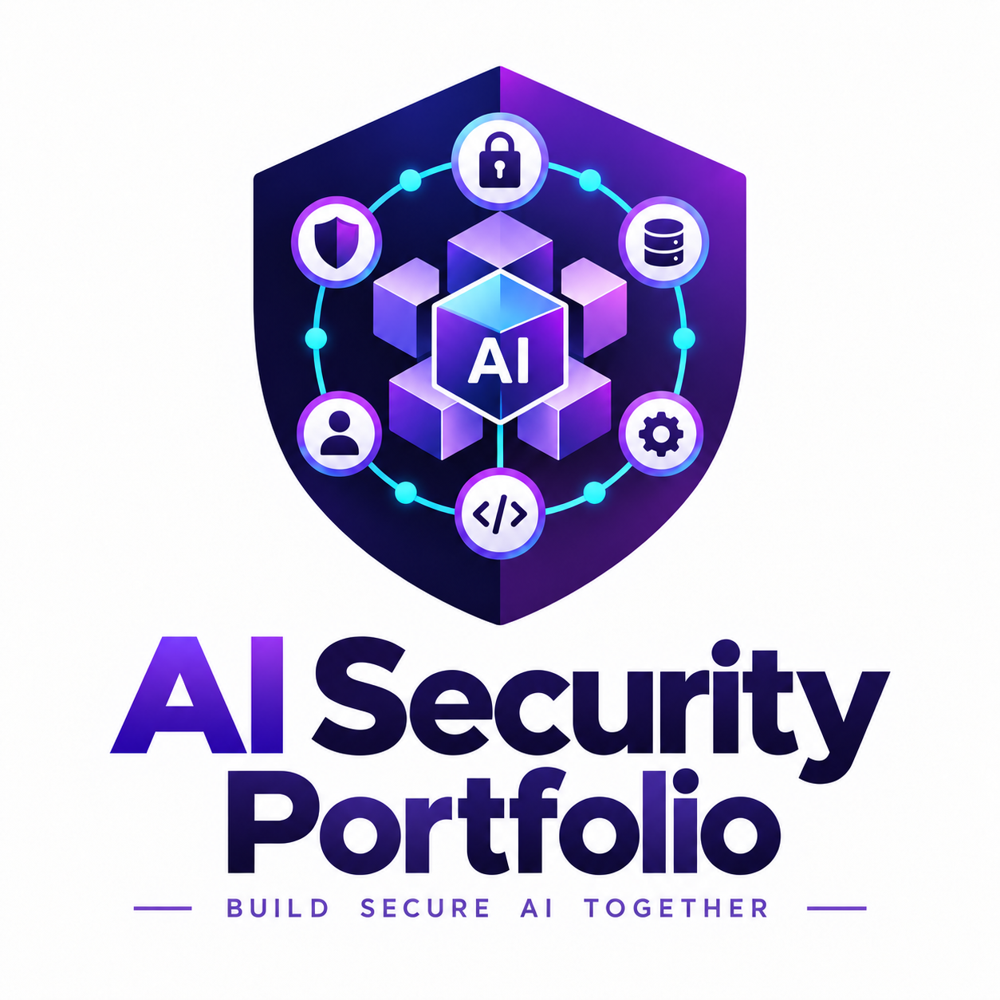

  

  <strong>Secure Enterprise AI Systems · IAM · Privacy Engineering · Audit and Data Lineage</strong>

  <a href="./secure-enterprise-mcp/README.md">Secure Enterprise MCP</a> •
  <a href="./privacy-hr-pipeline/README.md">Privacy Engineering</a> •
  <a href="./privacy-audit-system/README.md">Audit and Data Lineage</a> •
  <a href="./capstone/README.md">UC Berkeley MIDS Capstone</a>

# AI Security Portfolio

I explore how enterprise AI systems can enforce access boundaries, protect sensitive data,
and produce evidence of their behavior. This portfolio brings together independent
implementations and the backend and security architecture I designed and built for
my UC Berkeley MIDS capstone.

**My current focus is identity and access management (IAM):** connecting caller identity,
permissions, policy decisions, and execution boundaries with privacy controls and
audit evidence. The projects below examine complementary parts of that architecture;
they are separately documented projects, not a single integrated platform.

## Project map

| Project | Core question | Current scope |
| --- | --- | --- |
| [Secure Enterprise MCP](./secure-enterprise-mcp/README.md) | What may an agent's caller do, and where is that decision enforced? | Working search/read demo with scope authorization, policy enforcement, audit logging, and container deployment |
| [Privacy-Preserving HR Analytics](./privacy-hr-pipeline/README.md) | How can sensitive data remain useful while reducing disclosure risk? | Synthetic-data experiments with generalization, suppression, privacy checks, and noisy aggregate queries |
| [Audit Logging and Data Lineage](./privacy-audit-system/README.md) | What happened to the data, and how can its history be traced? | Structured audit events, artifact lineage, upstream/downstream traversal, and integrity validation |
| [MIDS Capstone: Secure Agent Execution](./capstone/README.md) | How can a shared platform execute user-submitted agent workloads with controlled access? | Documentation of my implemented backend, identity integration, execution infrastructure, and evaluation pipeline |

## 1. Secure Enterprise MCP

A security-focused Model Context Protocol implementation that enforces tool access
in application code, independently of model behavior.

- **Access controls:** principal scopes, declarative YAML tool policy, fail-closed
  authorization, trusted/quarantined data separation, and path traversal protection.
- **Execution:** MCP client and server communicate over stdio as separate processes
  inside a non-root Docker container. The analyst can search and read; the restricted
  user can search but is denied read access.
- **Evidence and CI:** structured authorization audit events, Python tests, Docker
  builds, and container smoke checks for allowed and denied requests.
- **Cloud infrastructure:** Terraform configuration for ECR, ECS Fargate, networking,
  execution IAM, and CloudWatch logging. The project documents successful Fargate
  runs for both demo identities and separate local Kubernetes Job validation.
- **Approval primitive:** an in-memory store binds expiring, single-use approvals to
  an exact principal, tool, document, and destination, with lifecycle audit events.

**Current boundary:** identity selection is simulated; it does not authenticate the
caller. The approval store is not yet connected to an outbound MCP tool or an
authenticated human approval interface. The Fargate deployment remains an on-demand
stdio demo, not a network-accessible MCP service.

**Stack:** Python, MCP, YAML, Docker, Terraform, AWS ECR/ECS Fargate, CloudWatch, Kubernetes.

[Explore the project](./secure-enterprise-mcp/README.md) ·
[Security model](./secure-enterprise-mcp/SECURITY.md) ·
[Architecture and design](./secure-enterprise-mcp/DESIGN.md)

## 2. Privacy-Preserving HR Analytics Pipeline

An independent privacy engineering project using synthetic employee data to examine
privacy and analytical utility together.

- Generates correlated synthetic HR data for reproducible experiments.
- Applies age generalization and small-group suppression for k-anonymity.
- Evaluates sensitive-attribute diversity and distributional closeness through
  l-diversity and t-closeness checks.
- Explores Laplace-noise aggregate queries and the effect of epsilon on accuracy.
- Documents retention, suppression, and utility tradeoffs, including demographic
  impacts of privacy thresholds.

**Current boundary:** these are synthetic-data experiments and implementation studies;
they do not establish a production privacy guarantee or compliance certification.

**Stack:** Python, Jupyter notebooks, synthetic data generation, privacy evaluation.

[Explore the privacy pipeline](./privacy-hr-pipeline/README.md)

## 3. Audit Logging and Data Lineage System

A companion project for recording data access and transformation history in the
HR privacy workflow, connecting privacy operations with inspectable evidence.

- **Audit records:** actor, operation, dataset or fields, stated purpose, and timestamp.
- **Artifact lineage:** versioned dataset metadata and transformations connecting input
  artifacts to outputs, including field changes and links to audit events.
- **Queries:** direct artifact history and recursive upstream/downstream traversal.
- **Validation:** checks for unknown artifact references, duplicate identifiers, and cycles.
- **Data engineering practice:** Databricks Bronze/Silver scripts for landing and
  validating persisted lineage records.

**Current boundary:** lineage is artifact-level and covers instrumented operations;
it does not retain row-level mappings or automatically observe activity outside the
pipeline. Recording a stated purpose is evidence, not purpose-based access enforcement.

**Stack:** Python, typed records, JSONL, Databricks practice scripts.

[Explore audit and lineage](./privacy-audit-system/README.md) ·
[Databricks practice](./privacy-audit-system/databricks/README.md)

## 4. UC Berkeley MIDS Capstone — Secure Agent Execution Architecture

Security and backend architecture developed as part of the UC Berkeley MIDS
capstone project for a platform that executed browser-based AI agent workloads.

My contributions included:

- Sandboxed execution of user-submitted agent code
- Docker-based isolation on EC2
- Auth0 identity integration
- User-scoped S3 storage
- Secret-gated internal services
- Rate limiting and API security
- Execution metadata and evaluation infrastructure

[View the capstone documentation](./capstone/README.md)

## Architecture narrative: how the work connects

The common thread is making security decisions explicit and their effects observable:

| Concern | Portfolio connection |
| --- | --- |
| Identity and permissions | Capstone Auth0 integration and user-scoped access; MCP simulated principals and tool scopes |
| Policy and execution boundaries | MCP authorization before tool execution; capstone API validation and per-request Docker execution |
| Data protection | HR privacy transformations and aggregate-query experiments; trusted-data boundaries in MCP |
| Evidence and provenance | MCP authorization/approval audit events; privacy audit records and artifact lineage |
| Evaluation and operations | Capstone execution analytics; privacy/utility experiments; MCP tests, CI, and container infrastructure |

The current IAM deep dive builds on these projects by tracing authentication,
authorization, and human approval as distinct controls. Future work includes real
caller authentication for MCP, finer-grained resource authorization, and connecting
approval to sensitive outbound actions with security evaluation scenarios.

Cross-project code integration will follow concrete use cases. For now, this README
connects the architecture and evidence while each project retains its own scope.
