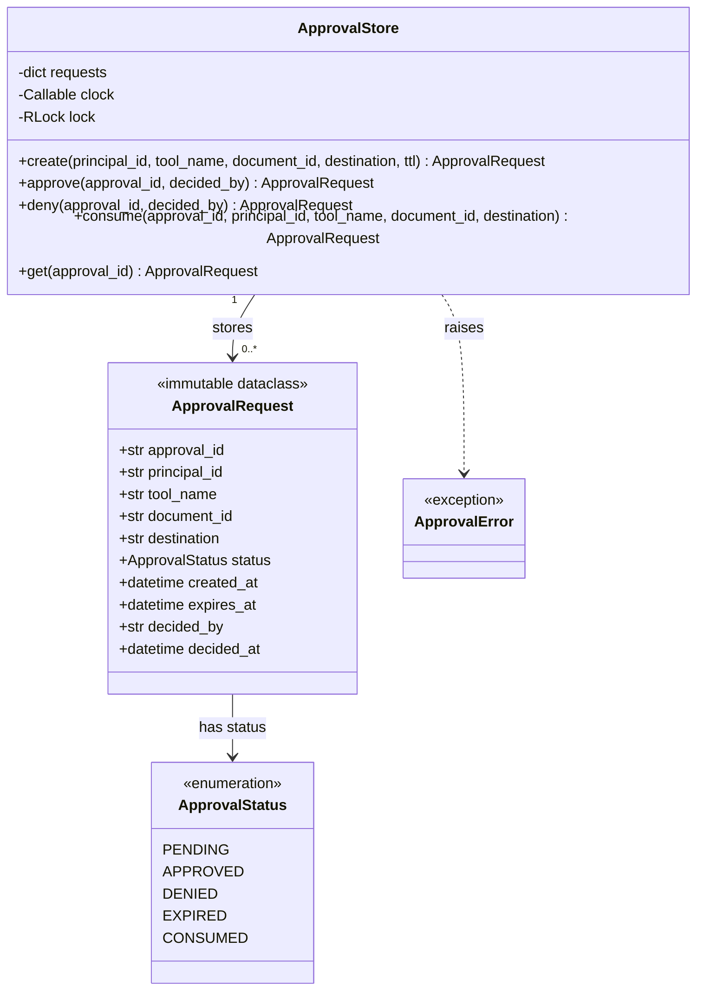
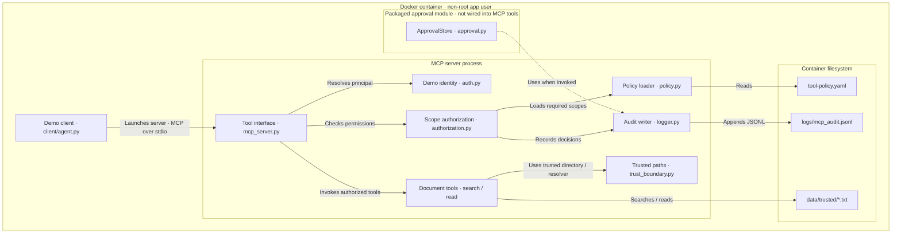

# SECTIONS:
- [Part 1 — MCP Implementation](#part-1---mcp-implementation)
- [Part 2 — Identity And Authorization](#part-2---identity-and-authorization)
- [Part 3 — Trust Boundary Implementation](#part-3---trust-boundary-implementation)
- [Part 4 — Audit and Security Observability](#part-4---audit-and-security-observability)
- [Part 5 — CI Build](#part-5---ci-build)
- [Part 6 — AWS and Terraform](#part-6---aws-and-terraform)


# PART 1 - MCP Implementation

Working MCP client/server for tool discovery with search and read documents

#### Inbound / Ingress Boundary
External → Quarantine → Inspection → Trusted

#### Outbound / Egress Boundary
Trusted → Export Controls → Approval → External

### secure-enterprise-mcp/mcl_server.py

    mcp 2.2.0
    MCPServer creation
    mcp_server.py startup
    stdio server waiting for client 

Search enterprise documents for text matching the query.

    Args:
        query: Text to search for.

    Returns:
        Metadata for documents containing the query.


    client
        ↓
    MCP tool discovery
        ↓
    search_enterprise_documents
        ↓
    search_documents
        ↓
    normal_document.txt
        ↓
    MCP response

### secure-enterprise-mcp/client/agent.py

- Server advertises search_enterprise_documents
- Tool list can be invoked through MCP

        client/agent.py
            │
            │ MCP over stdio
            ▼
        server/mcp_server.py
            │
            ▼
        search_enterprise_documents
            │
            ▼
        search_documents
            │
            ▼
        normal_document.txt
            │
            ▼
        structured MCP response

- Client accepts StdioServerParameters, list_tools() returns a result with tools are in .tools, 
and call_tool() returns a CallToolResult with structured_content

```
server_params = StdioServerParameters(
        command=sys.executable,
        args=["-m", "server.mcp_server"],
    )
```
- Logic forces the MCP subprocess to use the same Python interpreter as the client.

```
command=sys.executable
```

- SDK's studio launches:

    (.venv) burcu@Burcus-MacBook-Pro secure-enterprise-mcp % python -m client.agent
    Connected to server.

    Available tools:
      -> search_enterprise_documents

    Tool result:
    {'result': [{'document_id': 'normal_document.txt', 'name': 'normal_document'}]}

```
python -m server.mcp_server
```

### Checkpoint: MCP transport and first tool working end to end

## secure-enterprise-mcp/server/tools/read_document.py

- Accepts a filename from MCP to read
- Protects senstive files to be read without correct permisson level

## update secure-enterprise-mcp/mpp_server.py to expose read_document in tool list

    Secure Enterprise MCP
    │
    ├── search_enterprise_documents
    │
    └── read_enterprise_document

## update secure-enterprise-mcp/client/agent.py with two step flow

    query = "authorization"
            │
            ▼
    search_enterprise_documents
            │
            ▼
    normal_document.txt metadata
            │
            ▼
    extract document_id
            │
            ▼
    read_enterprise_document
            │
            ▼
    actual document contents

### Schema MCP recieves
    object
    ├── document_id : string
    ├── name        : string
    └── content     : string 


    search_enterprise_documents
            │
            │ -> list[dict]
            ▼
    structured_content
    {
    "result": [
        {
        "document_id": "normal_document.txt",
        "name": "normal_document"
        }
    ]
    }
            │
            ▼
    extract document_id
            │
            ▼
    read_enterprise_document
            │
            │ -> dict[str, str]
            ▼
    structured_content
    {
    "document_id": "normal_document.txt",
    "name": "normal_document",
    "content": "Quarterly Security Review..."
    }

```
python -m client.agent
```

    (.venv) burcu@Burcus-MacBook-Pro secure-enterprise-mcp % python -m client.agent
    Connected to server.

    Available tools:
    - search_enterprise_documents
    - read_enterprise_document

    Search result:
    {'result': [{'document_id': 'normal_document.txt', 'name': 'normal_document'}]}

    Document:
    Quarterly Security Review

    The security engineering team completed its quarterly review
    of enterprise AI integrations.

    The review covered identity management, authorization,
    audit logging, least privilege, and tool access controls.

    MCP servers should enforce authorization independently
    from instructions generated by an AI model.

### Checkpoint: Document extracted if permission level has met

# PART 2 - Identity And Authorization

## ADDING SECURITY COMPONENT: make tool-policy.yaml executable

>> Design Decisions:
- Load YAML file from a specific location
- If no security policy found, deny MCP tool lookup

             MCP request
                 │
                 ▼
          ┌──────────────┐
          │ Tool policy  │
          │   registry   │
          └──────┬───────┘
                 │
           policy exists?
              /      \
            no        yes
            │          │
          DENY         ▼
                 authorization
                      │
                      ▼
                    tool


- Policy describes what an MCP client is permitted to invoke:

        Internal implementation
                 │
                 ▼
          ┌──────────────-----┐
          │ search_documents  │
          │   read_document   │
          └──────┬───────-----┘
                 │
              wrapped by
                 |
           MCP Security Boundry
                 │
                 ▼
        ┌────────────────────────────┐
        │ search_enterprise_documents│
        │   read_enterprise_document |
        └────────┬───────────────────┘
                 │
             governed by
                 |
           tool-policy.yaml
                 │
                 ▼
        ┌────────────────────────────┐
        │ search_enterprise_documents│
        │   read_enterprise_document |
        |    send_document_external  |
        └───────────────────────────-┘

### Making the policy enforcable

- Added authorization layer (initial: test the security model with simple identity, then intorduce JWT/OAuth)
- implementation is in server/security/authorization.py


        tool request
            │
            ▼
        get_tool_policy(tool_name)
            │
            ▼
        required_scopes
            │
            ▼
        compare with user's granted scopes
            │
            |──► missing scopes ──► DENY
            │
            |──► all scopes present ──► ALLOW    

#### Test:

    python -m pip install -r requirements.txt
    python -m pip install pytest 
    python -m pytest -q 


```
>>> from server.security.authorization import authorize_tool
>>> analyst_scopes = {
...     "documents.search",
...     "documents.read",
... }
>>> authorize_tool(
...     "search_enterprise_documents",
...     analyst_scopes,
... )
>>> authorize_tool(
...     "read_enterprise_document",
...     analyst_scopes,
... )
>>> restricted_scopes = {
...     "documents.search",
... }
>>> authorize_tool(
...     "search_enterprise_documents",
...     restricted_scopes,
... )
>>> authorize_tool(
...     "read_enterprise_document",
...     restricted_scopes,
... )
Traceback (most recent call last):
  File "<python-input-11>", line 1, in <module>
    authorize_tool(
    ~~~~~~~~~~~~~~^
        "read_enterprise_document",
        ^^^^^^^^^^^^^^^^^^^^^^^^^^^
        restricted_scopes,
        ^^^^^^^^^^^^^^^^^^
    )
    ^
  File "/Users/burcu/github/ai-security-portfolio/secure-enterprise-mcp/server/security/authorization.py", line 25, in authorize_tool
    raise PermissionError(
    ...<2 lines>...
    )
PermissionError: Access denied for tool 'read_enterprise_document'. Missing required scopes: ['documents.read']

>>> authorize_tool(
...     "delete_everything",
...     analyst_scopes,
... )
Traceback (most recent call last):
  File "<python-input-12>", line 1, in <module>
    authorize_tool(
    ~~~~~~~~~~~~~~^
        "delete_everything",
        ^^^^^^^^^^^^^^^^^^^^
        analyst_scopes,
        ^^^^^^^^^^^^^^^
    )
    ^
  File "/Users/burcu/github/ai-security-portfolio/secure-enterprise-mcp/server/security/authorization.py", line 17, in authorize_tool
    policy = get_tool_policy(tool_name)
  File "/Users/burcu/github/ai-security-portfolio/secure-enterprise-mcp/server/security/policy.py", line 35, in get_tool_policy
    raise ValueError(f"No policy defined for tool: {tool_name}")
ValueError: No policy defined for tool: delete_everything
>>> 

```

    Known tool + sufficient scope → ALLOW

    Known tool + insufficient scope → DENY

    Unknown/unregistered tool → DENY


    auth.py
    "What scopes does this identity have?"
            │
            ▼
    authorization.py
    "Do those scopes permit this tool?"
            │
            ▼
    policy.py
    "What does this tool require?"


### WIRE Security Component with MCP

- Updated mcp_server.py for MCP tool itself to enforce policy before touching the underlying business logic.

### Added Authenticate and authorize with simple 

    auth.py
    "Who is this?"
        │
        ▼
    Principal
    user_id + scopes
        │
        ▼
    authorization.py
    "Is this principal allowed to invoke this tool?"
        │
        ▼
    policy.py
    "What scopes does the tool require?"

#### Test:
```
>>> from server.security.auth import authenticate_user
>>> analyst = authenticate_user("analyst")
>>> print(analyst)
Principal(user_id='analyst', scopes=frozenset({'documents.read', 'documents.search'}))
>>> print(analyst.user_id)
analyst
>>> print(analyst.scopes)
frozenset({'documents.read', 'documents.search'})
>>> restricted = authenticate_user("restricted_user")
>>> print(restricted.scopes)
frozenset({'documents.search'})
>>> authenticate_user("attacker")
Traceback (most recent call last):
  File "<python-input-7>", line 1, in <module>
    authenticate_user("attacker")
    ~~~~~~~~~~~~~~~~~^^^^^^^^^^^^
  File "/Users/burcu/github/ai-security-portfolio/secure-enterprise-mcp/server/security/auth.py", line 43, in authenticate_user
    raise PermissionError(f"Unknown user: {user_id}")
PermissionError: Unknown user: attacker
>>> 
```
    CURRENT_USER
        │
        ▼
    authenticate_user()
        │
        ▼
    Principal
        │
        │ scopes
        ▼
    authorize_tool()
        │
        ▼
    tool-policy.yaml
        │
    allow/deny

>> CURRENT_USER is deliberately a local simulation of authenticated identity.

### Update StdioServerParameters:

```
server_params = StdioServerParameters(
    command=sys.executable,
    args=["-m", "server.mcp_server"],
    env={
        "DEMO_USER": os.getenv("DEMO_USER", "restricted_user"),
    },
)
```

>> Test:
    '''
    (.venv) burcu@Burcus-MacBook-Pro secure-enterprise-mcp % DEMO_USER=analyst python -m client.agent
    Connected to server.

    Available tools:
    -> search_enterprise_documents
    -> read_enterprise_document

    Search result:
    {'result': [{'document_id': 'normal_document.txt', 'name': 'normal_document'}]}

    Document:
    Quarterly Security Review

    The security engineering team completed its quarterly review
    of enterprise AI integrations.

    The review covered identity management, authorization,
    audit logging, least privilege, and tool access controls.

    MCP servers should enforce authorization independently
    from instructions generated by an AI model.
    (.venv) burcu@Burcus-MacBook-Pro secure-enterprise-mcp % DEMO_USER=restricted_user python -m client.agent
    Connected to server.

    Available tools:
    -> search_enterprise_documents
    -> read_enterprise_document

    Search result:
    {'result': [{'document_id': 'normal_document.txt', 'name': 'normal_document'}]}
    Tool 'read_enterprise_document' failed: "Error executing tool read_enterprise_document: Access denied. Missing required scopes: ['documents.read']"

    Read tool failed:
    type='text' text="Error executing tool read_enterprise_document: Access denied. Missing required scopes: ['documents.read']" annotations=None meta=None
    (.venv) burcu@Burcus-MacBook-Pro secure-enterprise-mcp % 
    '''

    terminal shell
    DEMO_USER=analyst
        │
        ▼
    client/agent.py
        │
        │ explicitly forwards DEMO_USER
        ▼
    StdioServerParameters(env=...)
        │
        ▼
    server/mcp_server.py
        │
        ▼
    authenticate_user("analyst")
        │
        ▼
    Principal
    documents.search
    documents.read

>> This project uses simulated authentication to focus on MCP authorization architecture. Production identity would be established using validated OAuth/OIDC/Entra tokens rather than the DEMO_USER environment variable.

### Checkpoint: Authorize with simeple identity (to be replaced with JWT/OAuth) 

# PART 3 - Trust Boundary Implementation

I modeled both ingress and egress around the MCP boundary. Untrusted external content enters quarantine and is inspected before promotion, while outbound document transfer requires separate export authorization and explicit approval.

1. Ingest_external_document (sandbox/quarantine).

2. Prompt-injection test with a deliberately hostile document into quarantine and show that untrusted content cannot bypass authorization or directly trigger tools.

3. Promotion into trusted storage (after validation/approval).

4. Outbound side with separate export scope + approval (send_document_external).


                            ENTERPRISE TRUST BOUNDARY

                INBOUND                              OUTBOUND

        External source                         Trusted document
            │                                       │
            ▼                                       ▼
        ingest_external_document         send_document_external
            │                                       │
        authorization                         authorization
            │                                       │
        approval                              approval
            │                                       │
        quarantine                            DLP / policy checks
            │                                       │
        sandbox inspection                    simulated transfer
            │                                       │
        validation                                 external
            │
        trusted repository


### Least privilege case:

    document_operator
        search
        read

    ingest_operator
        search
        read
        ingest

    export_operator
        search
        read
        export

    EXTERNAL / UNTRUSTED
            │
            ▼
    ingest_external_document
            │
            ├── audit: request received
            ▼
    authorization
            │
            ├── audit: allowed / denied
            ▼
    quarantine
            │
            ├── audit: quarantined
            ▼
    sandbox inspection
            │
            ├── audit: passed / failed
            ▼
    approval / promotion
            │
            ├── audit: approved / denied
            ▼
    INTERNAL / TRUSTED

>> `server/security/trust_boundary.py` is the central denfinition of trust zones (therefore server/tools/read_document.py and search_documents.py have been updated to delegate the boundary enforcement to trust_boundary.py)

>> this segration also ensures that the two trusted tools supported with this project cannot accidentally wander into `data/quarantine/`

                            TRUST BOUNDARY

    UNTRUSTED                                TRUSTED
    ─────────                                ───────

    data/quarantine/                         data/trusted/
    untrusted_test.txt                       normal_document.txt
        │                                        │
        │                                        │
        └─────── X search/read cannot cross ─────┤
                                                 │
                                        MCP search/read

### What's the point?
- The agent doesn't need to “remember” not to read quarantine.

- The client doesn't need to behave correctly.

- The LLM doesn't need to recognize that the document is dangerous.

- The architecture prevents trusted document tools from reaching that trust zone.

### Checkpoint: Trust boundary has been defined

# PART 4 - Audit and Security Observability

                        AUDIT / OBSERVABILITY
                                │
    External ──► Ingress ──► Trusted ──► Egress ──► External
                │            │           │
                └────────────┴───────────┘
                        security events

    Record types:
        authorization allowed / denied
        document ingestion
        quarantine
        sandbox inspection (inspection passed / failed)
        trust promotion (promotion approved / denied)
        approval
        export requested
        export approved / blocked

>> <strong>Generalize security audit events and add automated tests for observability behavior.</strong>

>> `event_type`: What security relevant event occured - like:
    authorization_decision
    document_received
    document_quarantined
    sandbox_inspection
    trust_promotion
    approval_decision
    export_attempt

    user_id      = WHO is acting
    event_type   = WHAT security event happened
    tool_name    = WHICH capability was involved
    resource_id  = WHICH object/data item was affected
    outcome      = WHAT happened as a result

   ```
   {
    "user_id": "analyst",
    "event_type": "authorization_decision",
    "tool_name": "read_enterprise_document",
    "resource_id": "normal_document.txt",
    "outcome": "allowed"
    }
    ``` 


### Audit package
    server/
    └── audit/
        ├── __init__.py
        └── logger.py

### secure-enterprise-mcp/server/audit/logger.py

```
def log_tool_event(
    *,
    user_id: str,
    tool_name: str,
    outcome: str,
    details: dict[str, Any] | None = None,
) -> None:
```
>> Structured JSONL, not free-form strings. That makes the events usable later for SIEM ingestion, analytics, incident review, or policy monitoring. `details` rather than automatically serializing the entire MCP request. We do not want audit logging to become a second data-exfiltration channel by dumping document content, prompts, tokens, or credentials into logs.


    log_tool_event(...)
        ↓
    structured JSONL event written
        ↓
    logs/mcp_audit.jsonl


### Wiring audit into authorization flow:

- Updated authorization.py to accept principal ID and write an audit event for outcomes (allowed and denied).
- Updated mcp_server.py with one extra argument (`CURRENT_USER.user_id`) -  for both search and read. 

    authorize_tool(
        "search_enterprise_documents",
        CURRENT_USER.scopes,
    )

    authorize_tool(
        "search_enterprise_documents",
        `CURRENT_USER.user_id`,
        CURRENT_USER.scopes,
    )

    authorize_tool(
        "read_enterprise_document",
        `CURRENT_USER.user_id`,
        CURRENT_USER.scopes,
    )

```
(.venv) burcu@Burcus-MacBook-Pro secure-enterprise-mcp % python -m pytest -q -rP
.....                                                                                                                 [100%]
========================================================== PASSES ===========================================================
_____________________________________ test_allowed_authorization_writes_security_event ______________________________________
--------------------------------------------------- Captured stdout call ----------------------------------------------------

Allowed authorization audit event:
{
  "timestamp": "2026-09-22T17:11:38.831236+00:00",
  "user_id": "analyst",
  "tool_name": "read_enterprise_document",
  "outcome": "allowed",
  "details": {
    "required_scopes": [
      "documents.read"
    ]
  },
  "event_type": "authorization_decision",
  "resource_id": null
}
______________________________________ test_denied_authorization_writes_security_event ______________________________________
--------------------------------------------------- Captured stdout call ----------------------------------------------------

Denied authorization audit event:
{
  "timestamp": "2026-09-22T17:11:38.835964+00:00",
  "user_id": "restricted_user",
  "tool_name": "read_enterprise_document",
  "outcome": "denied",
  "details": {
    "missing_scopes": [
      "documents.read"
    ]
  },
  "event_type": "authorization_decision",
  "resource_id": null
}
5 passed in 1.36s
(.venv) burcu@Burcus-MacBook-Pro secure-enterprise-mcp % 

### Checkpoint: Added audit details on security events while keeping sensitve data out.

## 4.1 Send_Enterprise_Document

### 4.1.1 Approval Model and Approval Store

    - Approval model → ApprovalRequest + ApprovalStatus
    - Approval store / state machine → ApprovalStore

Approval represents explicit authorization for one exact sensitive action. It is bound to the requesting principal, tool, resource, and destination. It expires. It cannot be issued through the agent accessible MCP interface. It is single-use. And all state transitions are auditable.

        Approval Store Implementation

    Human Approval subsystem
    ├── ApprovalRequest model
    ├── ApprovalStatus state machine
    └── ApprovalStore
        ├── create → PENDING
        ├── approve → APPROVED
        ├── deny → DENIED
        ├── expire → read current state / expire if needed
        └── consume → validate exact request + APPROVED → CONSUMED

                    ┌──────────┐
                    │ PENDING  │
                    └────┬─────┘
                         │
             ┌───────────┼───────────┐
             │           │           │
             ▼           ▼           ▼
        ┌──────────┐ ┌────────┐ ┌─────────┐
        │ APPROVED │ │ DENIED │ │ EXPIRED │
        └────┬─────┘ └────────┘ └─────────┘
             │
             │ one permitted execution attempt
             ▼
        ┌──────────┐
        │ CONSUMED │
        └──────────┘

>> ```CONSUMED``` is added to avoid authorizing the same export repeatedly.
```
approval_id = xyz123
status = ARROVED 
without CONSUMED, the document can pass repeatedly.
```

```
approval_id = xyz123
status = ARROVED 
APPROVED -> CONSUMED 
this grants one action, avoids permanent permission.
```

>> Authorization alone is intentionally insufficient.
```
send request
      │
      ▼
valid authorization?
      │
     yes
      │
      ▼
valid approval?
   /       \
 no         yes
 │           │
BLOCK       continue
```

Approval is bound to

    principle
    tool
    document
    destination

>> Added Approval Stotre with secure-enterprise-mcp/security/approval.py supporting:

                    Agent / MCP

                        │
                        ▼

                  MCP Tool Request
                        │
                        ▼
               Authentication
                        │
                        ▼
                Authorization
                        │
                        ▼
                Policy Decision
                        │
                        ▼
            ┌─────────────────────┐
            │   Approval Store    │
            │                     │
            │ PENDING             │
            │ APPROVED            │
            │ DENIED              │
            │ EXPIRED             │
            │ CONSUMED            │
            └─────────────────────┘
                     ▲
                     │
              Human / Operator
              control plane

>> Test scope added in secure-enterprise-mcp/tests/test_approval.py:

    PENDING → APPROVED
    PENDING → DENIED
    PENDING → EXPIRED

    APPROVED → CONSUMED

    wrong principal     → BLOCK
    wrong tool          → BLOCK
    wrong document      → BLOCK
    wrong destination   → BLOCK

    reuse consumed ID   → BLOCK

### Checkpoint: In-memory Approval Store has been done. Tobe updated with persistent store.

### Approval Model

- The approval subsystem maintains immutable request records in an
in-memory store. Requests bind approval to a specific principal,
tool, document, and destination.



`decided_by` and `decided_at` are optional until a decision is recorded.
State transitions replace immutable records rather than modifying them.

- The store validates expiry and exact-action matching before consumption.
Its lock prevents concurrent reuse within the same store instance;
it does not provide coordination across processes or containers.

- The current store is an internal primitive, not an authenticated human
approval interface. It is not yet connected to an outbound MCP tool.

### 4.1.2. Audit update with Approval Store

- Updated sever/approval.py to trace 
    approval_request
    pending

- This would still not authorize anything as planned.

- And formated the audit log as:

    requested by analyst
    decided by security_operator
    decision approved/denied

- Logged expired in 5 minutes as designed TTL:

    APPROVED → EXPIRED

- Logged successfule lifecycle to be observable with CONSUMED:

    approval_request      pending
    approval_decision     approved
    approval_consumption  consumed

- Blocked Event: Logged actor attempting with wrong principle

- Blocked Event: Logged actor attempting with wrong tool call

- Blocked Event: Logged actor attempting with wrong document

- Blocked Event: Logged actor attempting with wrong destination
```
    Prompt injection Attack would output

        approval_consumption
        outcome = blocked

        reason = destination_mismatch

        approved:
        partner@example.com

        attempted:
        attacker@example.com

```

- Blocked Event: Logged replay test evidence 

    approval_consumption
    blocked
    reason = invalid_status
    status = CONSUMED

### Checkpoint: Prevent + Observe

        Prevent + Observe
    Authentication / simulated principals
                ↓
    Least privilege authorization
                ↓
    Trusted vs quarantined data boundary
                ↓
    Structured security audit logging
                ↓
    Human Approval Control Plane
        ├── immutable approval record
        ├── exact action binding
        ├── expiration
        ├── approve / deny
        ├── single use consumption
        ├── replay protection
        ├── concurrency protection
        └── structured approval audit events


### Current System Component Architecture

The client and server run as separate processes inside one Docker
container. Components below represent Python modules, not separate
microservices.



**Implementation boundaries**

- `DEMO_USER` selects a simulated principal at server startup; this is
  not production authentication.
- The MCP tool interface calls authorization before invoking document
  tools. The document helper functions do not independently check scopes.
- Search uses the trusted directory; read additionally validates the
  requested document path through the trusted-path resolver.
- The approval module is implemented and unit-tested, but the current
  MCP server does not instantiate it or expose an outbound tool.
- Audit events currently go to a local JSONL file. Stderr output and
  centralized cloud collection are not yet implemented.

# PART 5 - CI Build

The CI workflow validates the application and its Docker image
in a fresh GitHub-hosted environment.

- Workflow: `.github/workflows/mcp-ci.yml`, at the portfolio repository root.
- Triggers: relevant pushes to `main`, pull requests, or manual execution.
- Checks: Python tests, Docker image build, and container authorization smoke checks.
- Smoke checks verify that the analyst can search and read, while the
  restricted user can search but is denied read access. They inspect
  audit events and client results rather than relying only on exit codes.
- Shell commands run inside `secure-enterprise-mcp` through `working-directory`.
- The workflow's GitHub token has read-only repository contents access.
- This workflow does not publish the image or deploy the application.

# PART 6 - AWS and Terraform

- Establish a non-root AWS development identity.
- Use Terraform to define the image registry, task infrastructure, permissions, and logging.
- Publish the image and run both demo identities.
- Inspect results and clean up the resources we no longer need.

## AWS deployment preparation

A dedicated AWS member account separates MCP infrastructure from existing
portfolio workloads. Human access uses IAM Identity Center with MFA and
temporary AWS CLI credentials.

Initial provisioning uses an administrator permission set assigned only
to the sandbox account. Workload IAM roles will be defined separately
with least-privilege permissions.

AWS CLI authentication has been verified and Terraform installed.
Cloud deployment is not yet implemented. The next increment will define
an ECR image repository, followed by on-demand ECS/Fargate execution
and centralized CloudWatch logging.

## AWS infrastructure — container registry

### Implemented
- Dedicated MCP sandbox account with IAM Identity Center, MFA,
  and temporary CLI credentials.
- Terraform configuration in `infra/terraform`.
- Private ECR repository in us-east-1 with immutable image tags,
  AES256 encryption, and project/environment tags.
- AWS account validation through the provider's `allowed_account_ids`.
- Container image published as `demo-v1` and verified in ECR.

### State and access
- Terraform state is currently local and excluded from Git.
- The provider lock file is committed for reproducible provider selection.
- Human provisioning uses sandbox administrator access.
- Workload permissions will be defined separately.

### Cost monitoring
- Created a $20 monthly organization-wide budget with actual-spend
  email thresholds at $5, $10, and $20.
- A sandbox-specific budget remains pending because the new account
  was not available in the billing filter.
- Budget alerts do not enforce a spending cap.

## Design decisions:
- One public subnet, task public IP, no inbound security-group rules, outbound HTTPS.
- Execution role scoped to image pulls and log delivery; no application task role.
- 0.25 vCPU, 512 MiB, Linux/X86_64, non-root execution.
- Explicit blocking log delivery: backpressure may stall the application.
- On demand tasks with no continuously running ECS service.
- CloudWatch captures stdout/stderr, the container local audit file is short lived, 7 days.
- Demo output includes synthetic document content, sensitive data use will require removing that content from logs.