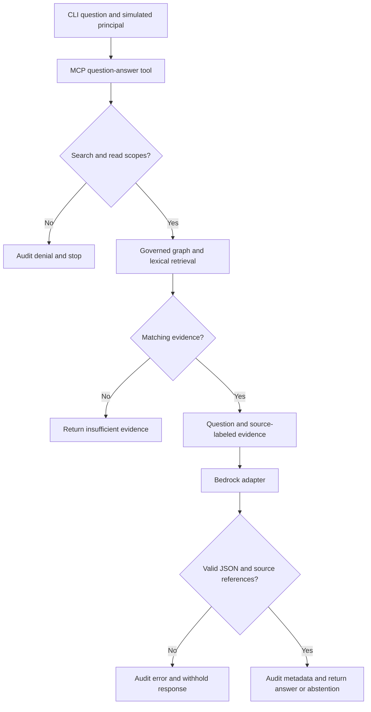
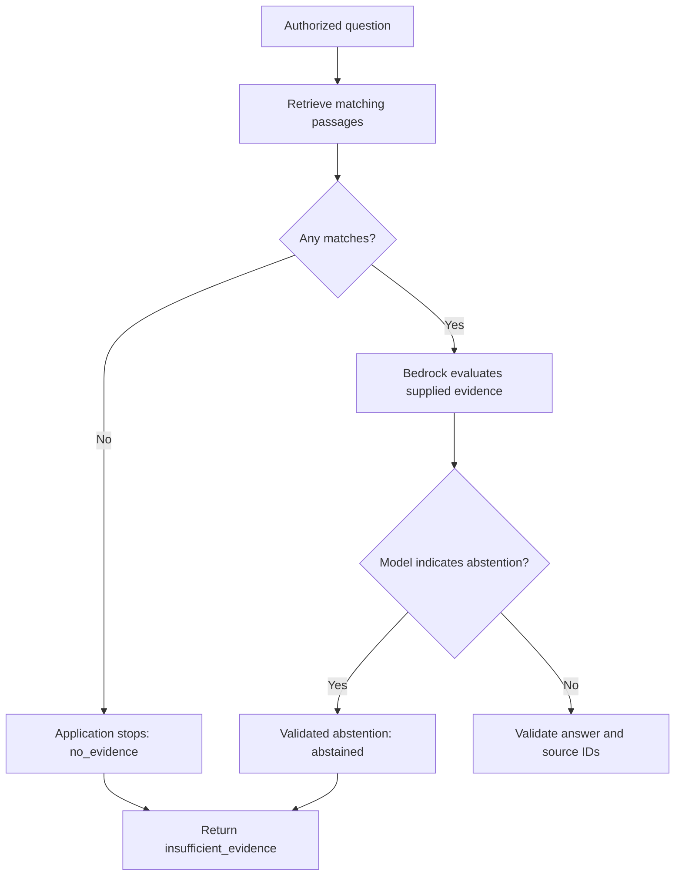

# Read-only RAG: implementation and study walkthrough

Status: Implementation and local walkthrough complete; two live
Bedrock cases verified from the developer laptop. Docker packaging and
RAG denial/no-evidence paths are verified. Live model access from a container
and Fargate redeployment of this increment remain unverified.

## What changed

The server now exposes `answer_enterprise_question(query)`. It requires BOTH
`documents.search` and `documents.read`. The application retrieves bounded,
provenance-backed relationships from a small governed knowledge graph and up to
three lexical passages from the synthetic trusted corpus. It sends that evidence
to a model, validates its JSON response and source references, and returns an answer.

Identity is still simulated. This is a fixed read-only workflow, not an autonomous
agent. All users with both scopes can access the same trusted corpus. There are
no per-document or per-tenant ACLs yet.

## Architecture

The LLM cannot call tools in this workflow: the Bedrock request contains no tool
configuration, and generated output is never executed. Retrieved text is treated
as data. That reduces action risk but does not prove resistance to answer poisoning.

## Code reading order

| File | Responsibility | Explain this aloud |
|---|---|---|
| `server/security/auth.py` | Existing simulated principals | Who is the caller, and what remains unverified? |
| `server/security/tool-policy.yaml` | New tool requires both scopes | Why must question-answering require read? |
| `server/mcp_server.py` | Registers the new MCP tool | Where does the principal come from? |
| `server/rag/service.py` | Authorization, orchestration, response validation, audit | Where does each failure stop execution? |
| `server/rag/graph_grounding.py` | Deterministic entity/relationship matching with document provenance | Why is a verified relationship stronger than vector similarity? |
| `server/rag/retrieval.py` | Deterministic lexical ranking and bounded passages | What makes a passage relevant, and what are the limitations? |
| `server/rag/models.py` | Bedrock Converse adapter | Which component needs AWS permission? |
| `client/rag_demo.py` | Calls the new tool over stdio | How do configuration and errors reach the caller? |
| `tests/test_rag.py` | Security and provider-contract tests | What was tested without a real model? |

## Allowed request

1. Launch the demo as `analyst` (simulation, not a login).
2. MCP dispatches to `answer_enterprise_question`.
3. `answer_question` calls the existing authorization function before retrieval.
4. Required search/read scopes are satisfied; authorization is audited.
5. The graph retriever matches governed entities and relationships, verifies each
   edge's trusted source document, and labels up to three facts G1, G2, G3.
6. The lexical retriever ranks passages by overlapping non-stopword query terms;
   at most three passages become evidence labeled S1, S2, S3.
7. The adapter calls Bedrock with instructions and JSON-encoded question/evidence.
8. The application checks response shape, types, and citation membership.
9. It records metadata and returns the answer with document IDs.

A valid citation ID proves that a source was supplied, not that every claim is
entailed by it. Review answer support separately.

## Denied request

`restricted_user` has search but not read. The scope difference contains
`documents.read`. Authorization raises ToolError. The RAG denial event records
no sources and `model_invoked: false`. No retrieval or model setup occurs.
The new CLI exits 1 for a tool error; the original client remains unchanged.

## No-evidence request

An authorized query with no graph or lexical matches returns `insufficient_evidence`
without constructing the model. If matching evidence is present but inadequate,
we ask the model to abstain and evaluate whether it does so correctly. That
semantic judgment is not guaranteed by the deterministic no-match check.

## Bounds and failure handling

- Nonempty query: maximum 2,000 characters.
- Corpus: maximum 100 `.txt` entries; each document maximum 32 KiB.
- Symlinks are skipped; paths use the existing trusted resolver.
- Three graph facts maximum and three lexical passages maximum. Passages use
  simple fixed 1,200-character slicing.
- The graph is limited to 200 nodes, 500 edges, and 64 KiB. Every edge must name
  an existing regular `.txt` file inside the trusted corpus as provenance.
- Model output budget: 600 tokens; SDK connection timeout 5 seconds, read timeout
  45 seconds, at most two attempts. These are not a single end-to-end deadline.
- Non-normal completion, malformed JSON, unknown citations, and provider errors
  do not return raw model output or provider exception messages to the caller.
- Metadata audit includes request ID, sources, outcome, model ID, elapsed time,
  and token usage when available. No question, passage, or generated answer is
  added by the new RAG audit events.
- `model_invoked` means invocation was attempted, not necessarily successful.
- Audit storage remains local JSONL plus stderr, with its existing limitations.
- CLI prints answers for the synthetic demo. Do not use it with sensitive documents
  without reviewing stdout collection and logging policy.

## What is not implemented

Verified user authentication; document ACLs; embedding/vector retrieval; reranking;
conversation memory; write tools; integrated human approval; shared-service scaling;
end-to-end request deadlines; live-model injection evaluation; a new cloud deployment.
The trusted directory must be controlled by the operator: path checks are not a
sandbox against an attacker who can concurrently modify server files.

The graph demonstrates deterministic, provenance-backed grounding; it does not
prove that a curator entered a fact correctly. Production governance would require
approved ingestion, ownership, effective dates, versioning, and change review.

## Bedrock and identities

1. Local AWS profile: developer's temporary credentials used by the SDK.
2. ECS execution role: image pull and platform log delivery.
3. Future ECS task role: application permission for Bedrock invocation.
4. MCP principal: simulated user tool permissions.

No Terraform resources were changed. The old Fargate task still runs the old
image and demo. A future Fargate deployment needs a scoped task role, an updated
image digest, model/region settings, and the RAG demo command. Do not add Bedrock
permissions to the execution role as a substitute for an application task role.

The adapter uses Bedrock Converse (`bedrock:InvokeModel`). Select a model supporting
Converse, system instructions, and the chosen region. Some models use inference
profiles requiring permissions on profile and underlying model resources. Model
availability and access must be confirmed in your account.

References:
- https://docs.aws.amazon.com/bedrock/latest/userguide/conversation-inference.html
- https://docs.aws.amazon.com/bedrock/latest/APIReference/API_runtime_Converse.html

## Validation recorded in this workspace

Python 3.12.14; MCP 2.2.0; boto3 1.43.124. Your Docker image uses Python 3.13;
the updated image was built locally and the container checks below passed.

- Original suite: 24 passed.
- Expanded suite: 40 passed at the first implementation checkpoint.
- Real stdio MCP restricted-user request: denied; no sources; no model invocation.
- Provider request contract: tested with an injected fake Bedrock client.
- Fake model answer path: tested, not proof of live LLM quality.
- Developer laptop: 40 tests passed in 3.00 seconds (user-provided terminal output).
- Live AWS invocation: two Nova Micro calls verified from the developer laptop.
  This is local application execution calling AWS, not a new Fargate deployment.

## Live evaluation record — November 5, 2026

| Scenario | Expected result | Observed result |
|---|---|---|
| Analyst asks incident response question | Supported answer and valid source IDs | Live answer supported by S1; omitted the ticket-data precaution, so not exhaustive |
| Analyst asks how many days logs must be retained | Abstain because duration is unspecified | Live model abstained; application returned its standard insufficient-evidence message |
| Restricted user asks same question | Denied before retrieval/model | Verified over MCP locally |
| Analyst asks about volcanoes | No evidence; no model call | Verified over MCP locally |
| Model returns nonexistent source ID | Reject response | Unit tested |
| Quarantined file or symlink matches query | Not included as evidence | Unit tested |
| Malicious instructions in a trusted passage | No actions; assess answer contamination separately | Prompt structure tested; live evaluation pending |

Both live calls used `amazon.nova-micro-v1:0` in `us-east-1` through the existing
local AWS SSO profile. No credential values are included in these notes.

| Question | Audit outcome | Sources | Input / output tokens | RAG latency |
|---|---|---|---|---|
| What is the incident response process? | answered | S1: incident_response_demo.txt | 224 / 71 | 2,587 ms |
| How many days must incident audit logs be retained? | abstained | S1: incident_response_demo.txt; S2: normal_document.txt | 321 / 36 | 2,328 ms |

Evidence source: user-provided terminal output reviewed during the walkthrough.
Latency is the service's recorded RAG duration, not isolated model latency or full
CLI startup time. Two observations do not establish reliable latency percentiles
or a general model-quality score. For abstention, the application intentionally
replaces generated answer text with its standard message and returns no citations;
the audit still retains the IDs of the sources supplied to the model.

## Quick Summary:

I extended my MCP authorization demo with a read-only RAG workflow. The server
checks both search and read scopes before retrieving evidence, so the new answer
tool cannot bypass the existing read restriction. A bounded lexical retriever
supplies labeled passages to a separate Bedrock adapter. I validate response
structure and source references and audit metadata. The identities remain
simulated. I verified a live evidence-backed answer and an abstention through
Bedrock, separately from deterministic tests. Broader quality evaluation and
cloud redeployment remain future work.

## Learning recap: distinctions verified in the walkthrough

| Concept | Meaning in this implementation |
|---|---|
| Identity | DEMO_USER is passed at server startup and resolved to CURRENT_USER; it is not supplied in each tool request and is not verified authentication. |
| Authorization | Each tool call compares that principal's scopes with YAML requirements. Restricted user has search only; analyst has search and read. |
| MCP | The Python client explicitly selects the question-answer tool through MCP; the model does not choose tools. |
| Retrieval | Local lexical search selects passages; a match does not prove sufficient evidence. The immutable stop-word set reduces common-word noise, not access rights. |
| RAG | Retrieved evidence and the question are supplied to a model for generation. |
| Model adapter | configured_model creates the real Bedrock adapter. Only tests substitute fake models or AWS clients. |
| Model selection | BEDROCK_MODEL_ID selects the resource, not the AWS caller identity. |
| AWS identity | SDK credentials identify the caller. Application scopes do not grant AWS IAM permissions. |
| Generation | Nova Micro composes the answered response from supplied evidence; Python does not contain a canned incident-response answer. |
| Citation validation | Checks that a source ID was supplied; does not check whether the source entails the claim. |
| Faithfulness evaluation | Compare actual answer claims with passages. Sentiment classification and word similarity do not establish entailment. |
| Request input vs weights | Instructions and evidence change the input, not the model's learned numerical weights. No training or fine-tuning occurs. |
| Freshness | Each authorized request reads files again. No conversation history, retrieval cache, or vector index is used. |
| Approval | Separate from authorization; no human approval is required or invoked by this read-only tool. |

### The two insufficient-evidence paths

Application-enforced no-match stopping and model-indicated abstention are separate
behaviors. The second can fail on other inputs and must be evaluated.

## Frozen scope and next checkpoint

No additional features are needed for this increment. 

The updated container build, original smoke checks, and new RAG denial/no-evidence
paths are verified. Next review and commit the implementation and documentation.

OAuth, semantic retrieval, agent-selected tools, write actions, and scaling remain backlog items.

## Container validation — November 5, 2026

| Check | Observed result |
|---|---|
| Original analyst smoke test | PASS: search allowed, read allowed |
| Original restricted-user smoke test | PASS: search allowed, read denied |
| RAG restricted-user request | Denied for missing documents.read; no sources; model_invoked=false |
| RAG analyst query: volcanoes | no_evidence; insufficient_evidence; model_invoked=false |

Evidence: Docker build and terminal results from the developer laptop. The
restricted RAG command deliberately returns a tool error for denied access.
Docker's generic debugging suggestion does not indicate a defect in this case.

No AWS credentials were passed into these containers. Live Bedrock generation
was verified separately from the local Python environment. These checks do not
establish live model access inside Docker or deployment of this increment to Fargate.
